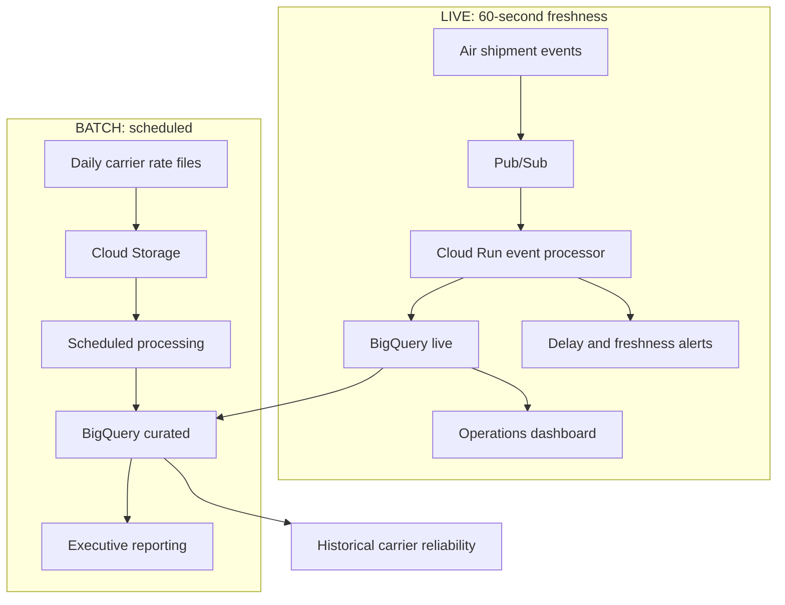

# Helix Pharma (SHP07) — Platform Architecture

## Customer requirements

- Freshness: 60 seconds
- Reliability: 99% on-time arrivals per lane
- Budget: $60/month
- Transport: Air freight

## Architecture diagram

## Changes from reference architecture

| Component | Decision | Reason |
|---|---|---|
| Shipment events | Keep LIVE | 60-second freshness |
| Pub/Sub | Keep LIVE | Managed ingestion |
| Kafka | Remove | Reduce cost and complexity |
| Dataflow | Replace with Cloud Run | Lightweight processing |
| BigQuery live | Keep LIVE | Operational visibility |
| Operations dashboard | Keep LIVE | Shipment monitoring |
| Rate files | Keep BATCH | Daily input |
| Cloud Storage | Keep BATCH | Raw file storage |
| Dataproc | Replace with scheduled processing | Avoid cluster cost |
| BigQuery curated | Keep BATCH | Historical analytics |
| Executive reporting | Keep BATCH | Scheduled reports |
| Delay alerts | Add LIVE | Investigate late shipments |
| Carrier reliability | Add BATCH | Track 99% target |

## Evidence

BigQuery results for SHP07:

- ICN to FRA: 97.0% on time
- SIN to LHR: 97.6% on time
- HKG to LAX: 97.7% on time
- Target: 99% on every lane

All three lanes currently miss the reliability target.

## Design limitations

- The 60-second freshness target is not yet tested.
- Live processing requires an event source.
- Temperature alerts require temperature data.
- Cloud costs must be checked against the $60/month budget.
